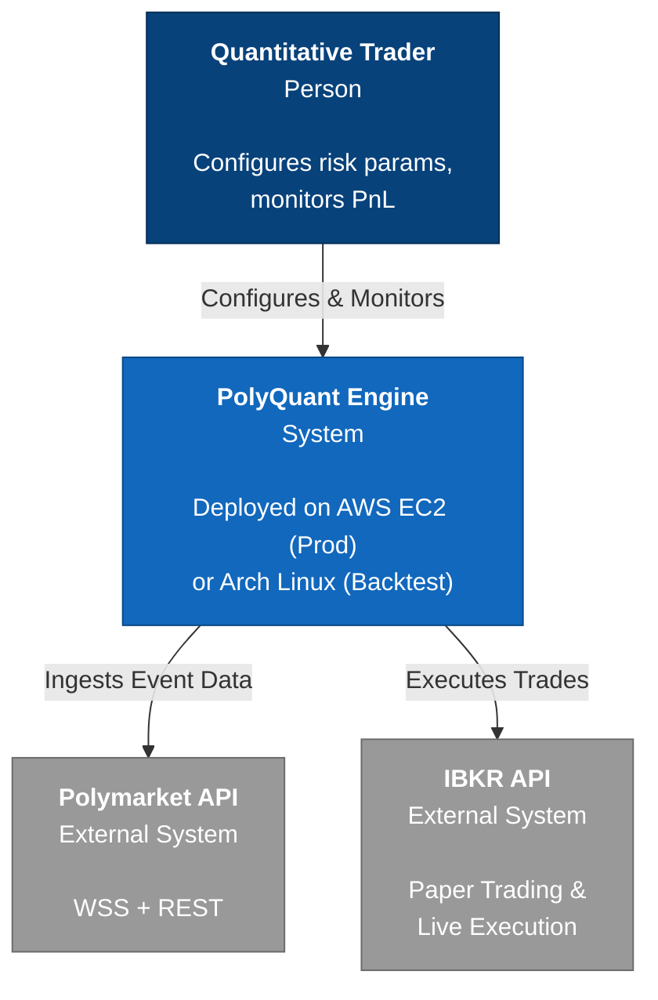
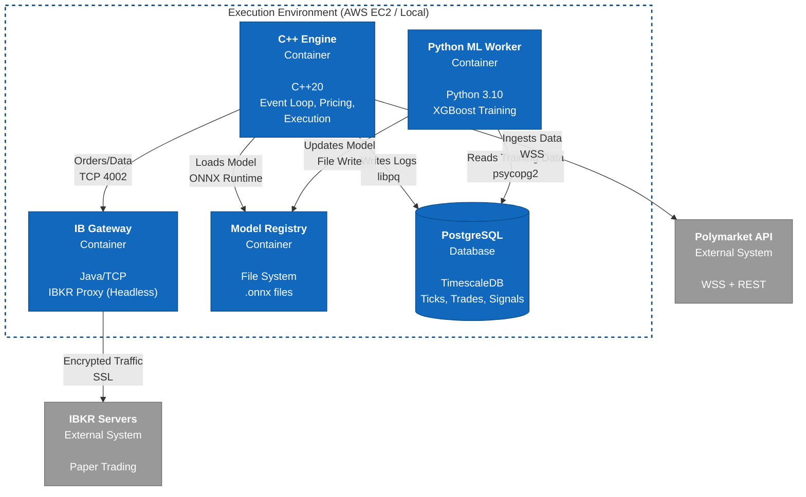
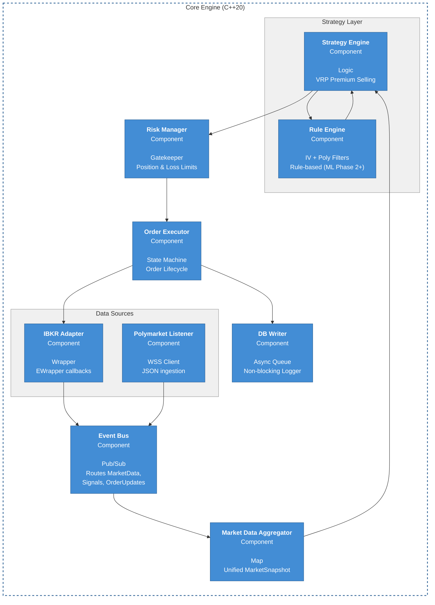

# System Architecture

This document describes the PolyQuant system architecture using the C4 model (Context, Container, Component, Code).

## Table of Contents

1. [Overview](#overview)
2. [Level 1: System Context](#level-1-system-context)
3. [Level 2: Container Diagram](#level-2-container-diagram)
4. [Level 3: Component Diagram](#level-3-component-diagram)
5. [Data Flow](#data-flow)
6. [Technology Stack](#technology-stack)
7. [Observability](#observability)

---

## Overview

PolyQuant is an event-driven VRP premium selling system (iron condors, credit spreads) with three primary external integrations:
- **Polymarket API**: Real-time prediction market data (WebSocket)
- **IBKR API**: Options market data and trade execution (TCP)
- **User**: Configuration and monitoring

The system runs in two environments:
- **Local (Dev/Sim)**: Arch Linux workstation for development and backtesting
- **Cloud (Prod)**: AWS EC2 for 24/7 production trading

---

## Level 1: System Context

Interactive Brokers (IBKR) serves as the sole brokerage. The system runs in two environments: Local (Sim) or AWS (Prod).



### External Systems

| System | Protocol | Purpose | Latency SLA |
|--------|----------|---------|-------------|
| **Polymarket** | WSS | Real-time probability updates | <100ms |
| **IBKR Gateway** | TCP (TWS API) | Market data + order execution | <50ms |
| **User Dashboard** | HTTP (Grafana) | Monitoring and configuration | N/A |

---

## Level 2: Container Diagram (Deployment View)

This diagram details the software containers. The Execution Environment changes based on the phase (Local vs Cloud), but the internal containers remain identical.



### Container Responsibilities

| Container | Technology | Responsibility | Scaling |
|-----------|-----------|----------------|---------|
| **C++ Engine** | C++20, Boost, ONNX | Core trading logic, event processing | Single instance (stateful) |
| **IB Gateway** | Java (IBKR provided) | Broker connection proxy | Single instance per account |
| **Model Registry** | File system | ONNX model versioning | Shared volume (read-only for C++) |
| **PostgreSQL** | TimescaleDB 2.0+ | Time-series storage | Single instance (Phase 1-2), RDS (Phase 3) |
| **Python ML Worker** | Python 3.10 | Model training (cron: nightly) | Single instance (batch job) |

---

## Level 3: Component Diagram (Core Engine)

This section details the internal class structure of the C++ Core Engine container.



### Component Details

#### Data Sources Layer

**IBKR Adapter**
- Implements `EWrapper` interface from TWS API
- Handles callbacks: `tickPrice()`, `tickOptionComputation()`, `orderStatus()`
- Manages reconnection on disconnect (error code 502)
- **Thread Model**: Dedicated reader thread for `client->run()`

**Polymarket Listener**
- WebSocket client (boost::beast)
- Subscribes to filtered markets (Mag 7 tickers only)
- Parses JSON messages, normalizes probabilities to [0, 1]
- **Thread Model**: Async I/O (boost::asio)

#### Core Logic Layer

**Event Bus**
- Pub/Sub pattern (observer/observable)
- Decouples producers (adapters) from consumers (strategy)
- Event types: `MarketDataUpdate`, `SignalGenerated`, `OrderUpdate`
- **Thread Model**: Single-threaded, events processed sequentially

**Market Data Aggregator**
- Maintains `std::unordered_map<ContractID, MarketSnapshot>`
- Merges Polymarket probabilities with IBKR Greeks
- Calculates derived metrics (IV percentile, spread %)
- **Lifetime**: Persistent (maintains state across events)

**Strategy Engine**
- Evaluates credit spread and iron condor opportunities
- Uses IV percentile, Polymarket certainty, and divergence filters
- Selects trade type based on poly_prob direction (put credit spread, call credit spread, or iron condor)
- Proposes multi-leg spread orders to Risk Manager
- **Execution**: Event-driven (triggered by EventBus)
- **Current State**: Still implements old call-buying logic, pending rewrite

**Rule Engine** (Phase 2+: ML Predictor)
- Rule-based signal evaluation: IV percentile > 50, poly certainty > 70%, divergence > 10%
- Short strike delta ~0.20, long strike delta ~0.08
- Credit-to-width ratio > 0.30
- **Phase 2+ Enhancement**: Replace with ONNX ML model for signal strength prediction

#### Safety Layer

**Risk Manager**
- Pre-trade checks:
  - Position size < 5% account
  - Sector exposure < 15%
  - Daily loss < -2% → HALT
  - Spread < 5%
- Post-trade monitoring:
  - Continuous PnL tracking
  - Circuit breaker triggers
- **Veto Power**: Can reject any order

**Order Executor**
- State machine: `PENDING → SUBMITTED → [FILLED | CANCELLED]`
- Tracks partial fills
- Retry logic (max 3 attempts)
- **Timeout**: 60 seconds per order

#### Persistence Layer

**DB Writer**
- Async queue (lock-free ring buffer)
- Batch writes (flush every 1 second OR 100 records)
- Writes: `market_data_ticks`, `signals`, `trades`
- **Non-blocking**: Trading continues even if DB is slow

---

## Data Flow

### Typical Trade Execution Flow

```
1. Polymarket Update
   ↓
2. EventBus::publish(MarketDataUpdate)
   ↓
3. DataAggregator::update_snapshot()
   ↓
4. Strategy::evaluate_spread_opportunity()
   ↓
5. RuleEngine::check_filters(iv_pct, poly_certainty, divergence)
   ↓
6. Risk::check_pre_trade_limits(spread_order)
   ↓
7. Execution::place_multi_leg_order()
   ↓
8. IBKR::reqOrder() → TCP packet sent
   ↓
9. IBKR callback: orderStatus("Filled")
   ↓
10. DBWriter::log_trade()
```

**Target Latency**: <50ms from step 1 → step 8

---

## Technology Stack

### Core Dependencies

| Layer | Technology | Version | Purpose |
|-------|-----------|---------|---------|
| **Language** | C++20 | GCC 11+ / Clang 13+ | Core engine |
| **Networking** | Boost.Asio | 1.80+ | Async I/O |
| **WebSocket** | Boost.Beast | 1.80+ | Polymarket WSS |
| **JSON** | nlohmann/json | 3.11+ | Message parsing |
| **Database** | libpqxx | 7.7+ | PostgreSQL client |
| **Logging** | spdlog | 1.11+ | Structured logging |
| **ML Inference** | ONNX Runtime | 1.17+ | Model execution |
| **Testing** | Google Test | 1.13+ | Unit tests |
| **Build** | CMake | 3.20+ | Build system |

### Python Dependencies (ML Training)

```
xgboost==2.0.3
scikit-learn==1.4.0
onnx==1.15.0
onnxruntime==1.17.1
skl2onnx==1.16.0
pandas==2.2.0
numpy==1.26.3
psycopg2-binary==2.9.9
```

---

## Observability

### Metrics (Prometheus)

See detailed metrics in main README. Key technical metrics:

#### Performance Metrics
- `polyquant_event_bus_queue_depth` - Pending events (should be ~0)
- `polyquant_order_latency_ms{quantile="0.95"}` - 95th percentile latency
- `polyquant_db_write_queue_depth` - Async write buffer size
- `polyquant_onnx_inference_time_ms` - ML model inference time

#### System Health
- `polyquant_feed_latency_ms{source="polymarket|ibkr"}` - Data feed lag
- `polyquant_reconnect_count{source="polymarket|ibkr"}` - Connection stability
- `polyquant_thread_pool_utilization` - CPU usage by component

### Logging

**Levels**:
- `TRACE`: Event-by-event debugging (disabled in prod)
- `DEBUG`: Component lifecycle (startup, shutdown)
- `INFO`: Trade executions, signal generations
- `WARN`: Spread widening, reconnections, position reviews
- `ERROR`: Order rejections, risk limit breaches
- `CRITICAL`: Circuit breakers, system shutdowns

**Format** (JSON for production):
```json
{
  "timestamp": "2025-02-13T14:32:10.543Z",
  "level": "INFO",
  "component": "strategy_engine",
  "event": "trade_entry",
  "ticker": "NVDA",
  "signal_strength": 0.85,
  "order_id": 12345
}
```

### Tracing

**Distributed Tracing** (Phase 3 only):
- Use OpenTelemetry C++ SDK
- Trace ID propagated through EventBus
- Spans: `polymarket_update → signal_generation → order_placement`

---

## Performance Characteristics

### Latency Breakdown (Target)

| Stage | Target | Notes |
|-------|--------|-------|
| Polymarket → EventBus | <5ms | Network + parsing |
| EventBus → Strategy | <10ms | In-memory routing |
| ML Inference | <5ms | ONNX optimized model |
| Risk Checks | <5ms | In-memory state |
| Order Submission | <25ms | IBKR TCP round-trip |
| **Total** | **<50ms** | End-to-end |

### Resource Usage (Phase 1 Target)

- **CPU**: 50-70% of 1 core (average), <2 cores peak
- **Memory**: 2-4 GB RSS (market data cache + model)
- **Network**:
  - Inbound: ~100 KB/s (Polymarket + IBKR ticks)
  - Outbound: ~10 KB/s (orders + DB writes)
- **Disk**:
  - Reads: ~1 MB/s (model loading)
  - Writes: ~5 MB/hour (DB inserts, logs)

---

## Deployment Models

### Phase 1: Local Development
```
[Arch Linux Workstation]
  ├── polyquant_engine (native binary)
  ├── IB Gateway (Java, localhost:4002)
  ├── PostgreSQL (systemd service)
  └── Python ML worker (cron job)
```

### Phase 2: Local Production
```
[Arch Linux Workstation]
  ├── polyquant_engine (systemd service)
  ├── IB Gateway (systemd service with auto-restart)
  ├── PostgreSQL (systemd service)
  ├── Prometheus (Docker)
  └── Grafana (Docker)
```

### Phase 3: AWS Cloud
```
[AWS EC2 t3.medium]
  ├── Docker Compose:
  │   ├── polyquant_engine
  │   ├── ib_gateway
  │   ├── prometheus
  │   └── grafana
  └── [AWS RDS PostgreSQL]
```

---

## Security Considerations

### Secrets Management
- **Phase 1-2**: `config/secrets.env` (git-ignored)
- **Phase 3**: AWS Secrets Manager

### Network Security
- IBKR connection: Localhost only (no external exposure)
- Polymarket: HTTPS/WSS (certificate validation)
- Database: Localhost / VPC-only (Phase 3)
- Grafana: Reverse proxy with auth (Phase 3)

### Code Security
- No `eval()` or dynamic code execution
- Input validation on all external data
- SQL parameterized queries (libpqxx)
- Bounds checking on all array access

---

## Failure Modes & Recovery

See [STRESS_TESTING.md](STRESS_TESTING.md) for detailed scenarios.

**Key Recovery Strategies**:
1. **Polymarket Disconnect**: Buffer last known probabilities, halt new entries after 30s
2. **IBKR Disconnect**: Exponential backoff reconnect, preserve positions
3. **Database Offline**: Queue writes in memory (max 10K records), trading continues
4. **Model File Missing**: Refuse to start, alert operator
5. **OOM**: Graceful shutdown, dump state to disk

---

## Future Enhancements

**Considered but not implemented in Phase 1-3**:
- [ ] Multi-threading (pin components to CPU cores)
- [ ] GPU acceleration for ML inference
- [ ] Distributed architecture (separate signal generation from execution)
- [ ] Multi-broker support (add Tastyworks, Schwab)
- [ ] Real-time backtesting (replay historical data at speed)

---

**See Also**:
- [TRADING_STRATEGY.md](TRADING_STRATEGY.md) - Business logic implementation
- [DATABASE_SCHEMA.md](DATABASE_SCHEMA.md) - Persistence layer
- [API_INTEGRATION.md](API_INTEGRATION.md) - External system integration
