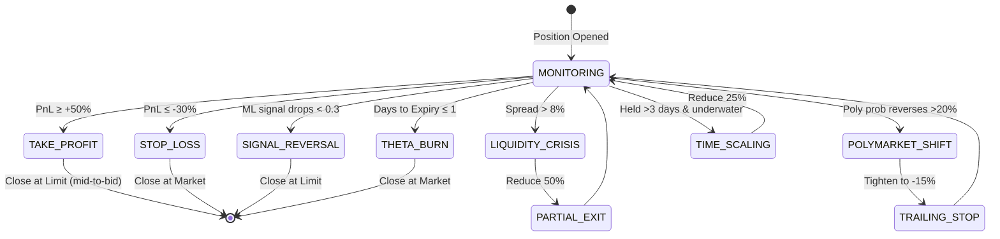

# Trading Strategy & Logic

Complete specification of PolyQuant's trading strategy, including entry/exit logic, Greeks usage, risk management, and position sizing.

## Table of Contents

1. [Strategy Overview](#strategy-overview)
2. [Target Universe](#target-universe)
3. [The Greeks](#the-greeks)
4. [Entry Criteria](#entry-criteria)
5. [Position Management](#position-management)
6. [Exit Logic](#exit-logic)
7. [Risk Management](#risk-management)
8. [ML Model](#ml-model)

---

## Strategy Overview

**Core Thesis**: Polymarket probabilities serve as a forward-looking sentiment gauge that can identify IV mispricing in options markets before broader participants react.

**Strategy Type**: Mean reversion on implied volatility with directional sentiment overlay

**Holding Period**: 1-7 days (average ~3 days)

**Direction**: Long options only (calls when bullish sentiment, puts when bearish)

---

## Target Universe

### The "Mag 7" Stocks

| Ticker | Company | Rationale |
|--------|---------|-----------|
| **AAPL** | Apple | Highest option liquidity, frequent events |
| **MSFT** | Microsoft | Tech sector leader, tight spreads |
| **NVDA** | NVIDIA | High volatility, active Polymarket coverage |
| **AMZN** | Amazon | Earnings-driven, good volume |
| **TSLA** | Tesla | Elon-driven sentiment spikes |
| **META** | Meta | Social/tech crossover events |
| **GOOGL** | Google | Regulatory events, AI developments |

**Selection Criteria**:
- Daily option volume > 100K contracts
- Average bid-ask spread < 3%
- Open interest > 10K per strike
- Polymarket markets exist for earnings/events

---

## The Greeks

### Delta (Δ): Direction & Hedge Ratio

**Definition**: $\frac{\partial V}{\partial S}$ - Rate of change of option price w.r.t. underlying

**Usage**:
- **Entry Filter**: Only trade 0.20 < Delta < 0.80
  - Avoids deep OTM (low probability of profit)
  - Avoids deep ITM (poor capital efficiency)
- **Position Monitoring**: Track delta to estimate P&L sensitivity
- **NOT used as probability**: Common mistake - delta ≠ probability of ITM

**Example**:
```
NVDA @ $500, buying 520 Call @ $15
Delta = 0.45
Expected P&L for $1 move in NVDA: 0.45 × 100 = $45
```

### Gamma (Γ): Convexity Risk

**Definition**: $\frac{\partial^2 V}{\partial S^2}$ - Rate of change of delta

**Usage**:
- **Risk Monitor**: High gamma = delta changes rapidly
- **ATM options have highest gamma**: Monitor during volatile events
- **No explicit entry filter**: Managed via delta range (0.20-0.80)

### Vega (ν): IV Sensitivity (Primary Profit Driver)

**Definition**: $\frac{\partial V}{\partial \sigma}$ - Sensitivity to implied volatility

**Strategy**:
- **Mean Reversion Bet**: Buy when IV is elevated but Polymarket signals calm
- **Entry Sweet Spot**: IV Percentile 50-70 (elevated but not extreme)
- **Avoid**: IV Percentile > 90 (fear pricing, mean reversion likely against us)

**Example**:
```
AAPL option: IV = 35% (65th percentile)
Polymarket: "AAPL earnings beat" = 75% (high confidence)
→ Market pricing uncertainty, but sentiment shows confidence
→ BUY signal (expect IV crush post-event)
```

### Theta (Θ): Time Decay Cost

**Definition**: $\frac{\partial V}{\partial t}$ - Daily time decay (always negative for long options)

**Usage**:
- **Expected Value Check**: Must satisfy `EV > abs(Theta × Expected_Days_Held)`
- **Acceleration Monitor**: Theta accelerates in final 7 days → exit by day 7 or 1 day before expiry
- **Daily Cost**: Factor into position sizing

**Example**:
```
Option premium: $10
Theta: -$0.15/day
Expected hold: 3 days
Cost: 0.15 × 3 = $0.45 (4.5% of premium)
→ Required edge must exceed 4.5% to be profitable
```

### Rho (ρ): Interest Rate Risk

**Ignored**: Short-dated options (<30 DTE) have minimal interest rate sensitivity

---

## Entry Criteria

### Primary Filters (ALL must pass)

#### 1. Event Timing
```
Condition: event_date >= option_expiry - 1 day
       AND event_date <= option_expiry + 7 days
```
- Ensures event occurs before option expires (with 1-day buffer)
- Allows event resolution to impact price

#### 2. ML Signal Strength
```
Condition: signal_strength > 0.80
```
- XGBoost model output (calibrated probability)
- Threshold tuned for ~65% win rate

#### 3. Liquidity Gate
```
Condition: (ask - bid) / mid < 0.05
```
- Ensures tight spreads (<5%)
- Validates during entry AND continuously while holding

#### 4. Delta Range
```
Condition: 0.20 < delta < 0.80
```
- Avoids lottery tickets (deep OTM)
- Avoids capital-inefficient deep ITM

### Risk-Adjusted Filters

#### 5. Expected Value Check
```python
EV = (win_prob × avg_profit) - (loss_prob × avg_loss) - (abs(theta) × expected_days_held)

Where:
  win_prob = signal_strength
  loss_prob = 1 - signal_strength
  avg_profit = 0.50 (50% take profit target)
  avg_loss = 0.30 (30% stop loss)
  expected_days_held = min(days_to_expiry, 7)

Condition: EV > 0.10 (10% minimum expected return)
```

**Example Calculation**:
```
signal_strength = 0.85
EV = (0.85 × 0.50) - (0.15 × 0.30) - (0.05 × 3)
   = 0.425 - 0.045 - 0.15
   = 0.23 (23% expected return)
→ PASS (exceeds 10% threshold)
```

#### 6. Position Sizing (Kelly Criterion)
```python
kelly_fraction = (win_prob × avg_profit - loss_prob × avg_loss) / avg_loss

Position_size = kelly_fraction × kelly_fraction_multiplier × account_value
Position_size = min(Position_size, 0.05 × account, available_sector_capacity)

Where:
  kelly_fraction_multiplier = 0.25 (use 1/4 Kelly for safety)
  available_sector_capacity = 0.15 × account - current_mag7_exposure
```

#### 7. Sector Exposure
```
Condition: sum(open_mag7_positions) < 0.15 × account_value
```
- Prevents concentration risk (all Mag 7 are correlated)

#### 8. IV Percentile Context
```
Preferred: 50 < IV_percentile < 70 (elevated but not extreme)
Avoid: IV_percentile > 90 (fear pricing)
```

---

## Position Management

### Entry Execution

**Order Type**: Limit order
**Price**: Mid-to-Ask (start at mid, walk up to ask over 60 seconds)
**Time in Force**: DAY
**Quantity**: Calculated from Kelly sizing, rounded to integer contracts

**Entry Algorithm**:
```
1. Calculate position size (Kelly formula)
2. Place limit order at mid price
3. If not filled in 30 seconds, reprice to (mid + ask) / 2
4. If not filled in 60 seconds, reprice to ask
5. If not filled at ask, CANCEL (spread likely widening)
```

---

## Exit Logic

### Exit Triggers (First to Fire Wins)



### Detailed Exit Rules

#### 1. Take Profit (+50%)
```
Trigger: unrealized_pnl_pct >= 0.50
Action: Place limit order at mid-to-bid price
Timeout: If not filled in 60 seconds, accept bid
```

#### 2. Stop Loss (-30%)
```
Trigger: unrealized_pnl_pct <= -0.30
Action: Market order (immediate)
Rationale: Protect capital, don't wait for recovery
```

#### 3. ML Signal Reversal
```
Trigger: Re-evaluate signal every hour
         IF new_signal_strength < 0.30 THEN exit
Action: Limit order at mid price
Timeout: If not filled in 60 seconds, market order
```

#### 4. Theta Acceleration
```
Trigger: days_to_expiry <= 1
Action: Market order
Rationale: Theta decay overwhelms any directional edge
```

#### 5. Liquidity Deterioration
```
Trigger: Current spread > 8%
Action: 
  - Reduce position by 50% at market
  - Hold remainder IF signal still valid (>0.8)
  - Full exit if spread > 12%
Rationale: Preserve capital, avoid trapped positions
```

#### 6. Polymarket Sentiment Reversal
```
Trigger: Polymarket probability shifts >20% against position
         Example: Was 75% bullish, now 55%
Action:
  - Tighten stop-loss from -30% to -15%
  - Give 30 minutes for recovery
  - If no recovery, exit at market
```

#### 7. Time-Weighted Scaling
```
Trigger: position_held > 3 days AND unrealized_pnl < 0
Action: Reduce position by 25% daily
Rationale: Cut losers gradually, avoid holding dead positions
```

### Market Event Overrides

**Halts/Circuit Breakers**:
```
Action: 
  - Cancel all working orders immediately
  - DO NOT attempt to close existing positions
  - Wait for trading to resume
  - Re-evaluate all positions when market reopens
```

**Earnings Announcements (Unexpected)**:
```
If event_date NOT in calendar:
  IF profitable: Close immediately pre-market
  ELSE: Hold through announcement (already losing, may benefit from surprise)
```

**IBKR Gateway Restart**:
```
Action:
  - Enter "safe mode"
  - Cancel new order submissions
  - Maintain existing positions
  - Resume normal operation after reconnection confirmed
```

---

## Risk Management

### Pre-Trade Checks (Enforced by Risk Manager)

```c++
class RiskManager {
  bool approve_order(const Order& order) {
    // 1. Position size check
    if (order.value > 0.05 * account_value) {
      log_rejection("Single position exceeds 5%");
      return false;
    }

    // 2. Sector exposure check
    double mag7_exposure = calculate_mag7_exposure();
    if (mag7_exposure + order.value > 0.15 * account_value) {
      log_rejection("Sector exposure would exceed 15%");
      return false;
    }

    // 3. Daily loss check
    if (daily_pnl_pct < -0.02) {
      log_rejection("Daily loss limit reached (-2%)");
      halt_trading();
      return false;
    }

    // 4. Spread check
    if (order.spread_pct > 0.05) {
      log_rejection("Spread exceeds 5%");
      return false;
    }

    // 5. Daily trade limit
    if (today_trade_count >= 10) {
      log_rejection("Daily trade limit reached (10)");
      return false;
    }

    return true;
  }
};
```

### Continuous Monitoring

**Position Monitoring (Every Tick)**:
- Update unrealized P&L
- Check stop-loss triggers
- Monitor spread widening
- Calculate current theta burn

**Kill Switch Triggers**:
```
Level 1 (5 seconds): Data feed lost
  Action: Stop new orders

Level 2 (30 seconds): Data feed still lost
  Action: Begin flattening positions at market

Level 3 (60 seconds): Data feed still lost
  Action: Full system shutdown, alert operator
```

**Daily Loss Circuit Breaker**:
```
IF daily_pnl_pct <= -0.02:
  - HALT all trading
  - Close all new positions (keep existing)
  - Send critical alert
  - Require manual reset next day
```

---

## ML Model

### Model Bootstrap (Cold Start)

**Problem**: Need data to train model, but need model to generate data

**Solution**: Transfer learning from historical data

**Step 1**: Manual Data Collection (Pre-Phase 1)
```
Collect 90 days of historical data:
  - Polymarket event outcomes
  - Corresponding option prices
  - Match events to options manually (20-30 samples)
```

**Step 2**: Label Historical Data
```python
def label_trade(event, option_data):
    # Simulate: "Would this trade have been profitable?"
    entry_price = option_data['price_at_signal']
    exit_price = option_data['price_at_event_resolution']
    
    pnl_pct = (exit_price - entry_price) / entry_price
    
    return 1 if pnl_pct > 0.50 else 0  # Binary: hit take-profit or not
```

**Step 3**: Train Initial Model
```python
import xgboost as xgb

# Conservative hyperparameters for small dataset
params = {
    'max_depth': 3,
    'learning_rate': 0.05,
    'n_estimators': 100,
    'objective': 'binary:logistic'
}

model = xgb.XGBClassifier(**params)
model.fit(X_train, y_train)

# Export to ONNX
from skl2onnx import to_onnx
onnx_model = to_onnx(model, X_train[:1].astype(np.float32))
```

**Step 4**: Active Learning (During Phase 1)
```
Every 10 resolved trades:
  - Retrain model with cumulative data
  - Gradually lower min_signal_strength threshold:
    * 0-20 trades: 0.85 (very conservative)
    * 21-50 trades: 0.82
    * 51+ trades: 0.80
```

### Model Features (10 inputs)

```python
features = [
    'poly_prob',                # Current Polymarket probability
    'poly_prob_change_24h',     # Δ over last 24 hours
    'poly_volume_usd',          # Trading volume
    'opt_delta',                # Option delta
    'opt_iv',                   # Implied volatility
    'opt_iv_percentile',        # IV rank (30-day)
    'days_to_expiry',           # Time remaining
    'spread_width_pct',         # Bid-ask spread
    'underlying_price_change_5d', # 5-day momentum
    'vix_level'                 # Market-wide fear gauge
]
```

### Model Monitoring

**Calibration Check**:
```sql
-- Bin predictions and compare to actual outcomes
SELECT 
  FLOOR(signal_strength * 20) / 20.0 AS predicted_bucket,
  AVG(signal_strength) AS avg_predicted,
  AVG(CASE WHEN actual_outcome THEN 1.0 ELSE 0.0 END) AS actual_win_rate,
  ABS(AVG(signal_strength) - AVG(CASE WHEN actual_outcome THEN 1.0 ELSE 0.0 END)) AS calibration_error
FROM signals
WHERE actual_outcome IS NOT NULL
GROUP BY predicted_bucket
HAVING COUNT(*) >= 5;
```

**Drift Detection**:
```python
rolling_20_win_rate = trades[-20:].win_rate()
avg_signal_strength = trades[-20:].avg_signal_strength()

if rolling_20_win_rate < (avg_signal_strength - 0.15):
    alert("Model drift detected: predicted {avg_signal_strength}, actual {rolling_20_win_rate}")
    review_model()
```

---

## Edge Analysis

**Why hasn't this been arbitraged away?**

1. **Infrastructure Barrier**: Retail lacks WebSocket infrastructure for Polymarket
2. **Data Integration Complexity**: Linking prediction markets to options is non-trivial
3. **Small Size**: Only profitable at <$10K per trade (institutions ignore)
4. **Sentiment vs Fundamentals**: Institutions focus on earnings models, not sentiment
5. **Alpha Decay**: Edge likely decays once Polymarket volume > $10B (currently ~$2B)

**Expected Lifespan**: 2-3 years before mainstream adoption

---

**See Also**:
- [MATH_SPECS.md](MATH_SPECS.md) - Greeks calculation implementation
- [API_INTEGRATION.md](API_INTEGRATION.md) - Polymarket data ingestion
- [CONFIGURATION.md](CONFIGURATION.md) - risk_params.yaml tuning
